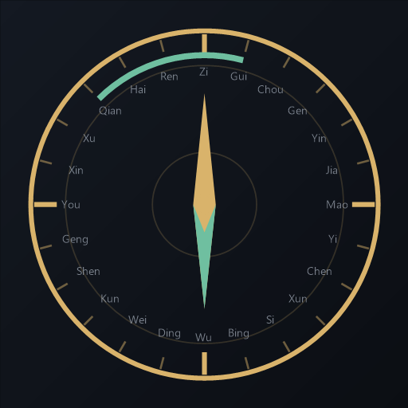
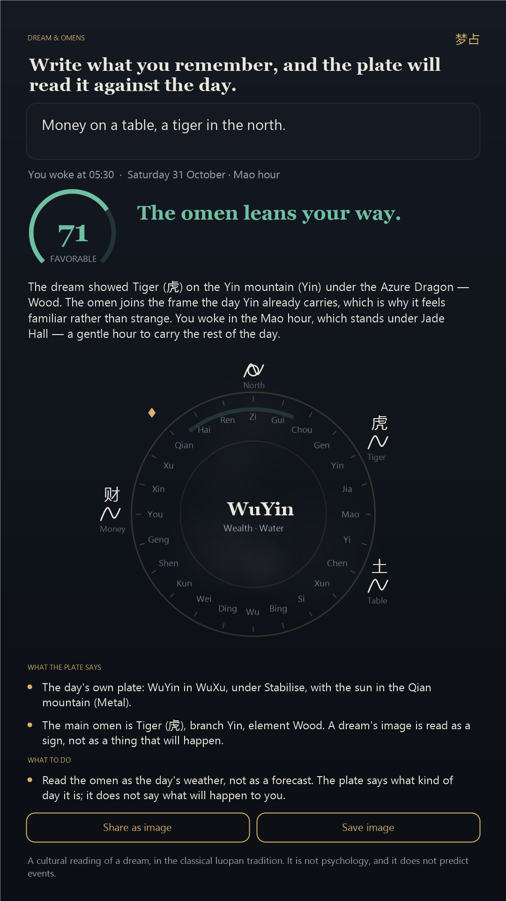
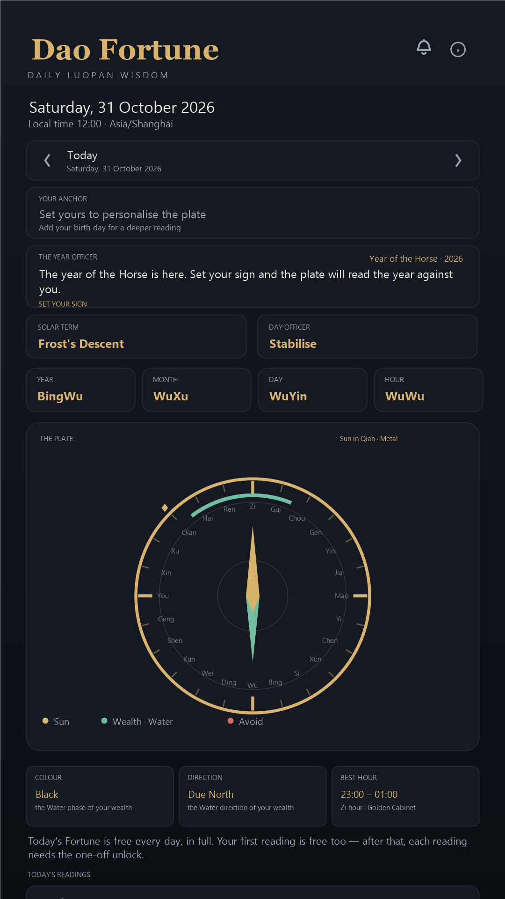

# Dao Fortune — Daily Luopan Wisdom

An Android app that reads your day through the **twenty-four mountains of the Chinese luopan** and
answers one practical question: is today a day to expect an unexpected gain, to push a deal, to open
a conversation, or to hold still?

Everything is computed on-device from classical rules. There is no server, no account, no analytics,
and no random number anywhere in the reading.



> **Repository:** https://github.com/sangaj/dao-fortune
> **Privacy policy (hosted):** https://sangaj.github.io/dao-fortune/privacy-policy.html

---

## What the app does

| Module | The question it answers |
|---|---|
| **Today's Fortune** | What is the overall quality of the day for me? |
| **Windfall & Wealth** | Is unexpected money likely to arrive today, from which direction, and in which hours? |
| **Love & Bonds** | Is this a day to open up, or a day to say it carefully? |
| **Career & Ambition** | Push, pitch, sign — or hold? |
| **Body & Balance** | Which of the five phases is loudest in my body today? |

Every reading shows **the factors that produced its score**, so the number is never a black box.

### Around the reading

| Feature | What it does |
|---|---|
| **Favourable Days** | The next sixty days are scored on the same day-plate rules and ranked for the move you have in mind — a financial move, signing, love & weddings, moving, your body, or a launch — so you can see *when* to act, not just whether today is good. |
| **Any date** | Step day by day or open the calendar. A day that is not today is read as a **day plate** — no hour is involved, because a day that has not happened yet has no hour. |
| **Your year sign** | Choose your zodiac branch once and every reading is measured against your own position on the plate: harmony, three-harmony, clash or harm against the day's branch, and the element tone between your branch and the day's. |
| **Your birth day (optional)** | For a deeper anchor, add the day you were born: every reading is then measured against that day's own pillar. A birth day is optional, lives only on your device, and is excluded from backup. |
| **The Year Officer card** | Once your sign is set, the home screen reads the year itself against you — harmony, frame, clash (the fan taisui year) or quiet harm — in one free card. With no sign set, the card is the invitation to choose one. |
| **The day at a glance** | Under the plate: the day's colour (the five-phase colour of the wealth element), the direction to face and the best double-hour — the ten-second read, drawn from the same plate as the full readings. |
| **Daily reading notification** | The bell in the top bar switches on one local notification each morning at eight — the day's score and headline. Scheduled with WorkManager, computed on the device, no network. If you decline the permission the bell stays off and the app says why. |
| **Home-screen widget** | A Glance widget shows today's score, verdict, headline and best window. The launcher asks it to refresh every 30 minutes, so it stays true even if you never open the app. |
| **Day reminders** | Each favourable day in the forward scan has a bell: tap it and a one-off WorkManager task posts a reminder at eight on that morning. No exact-alarm permission is used — a reminder is a nudge, not a medicine dose. |
| **The first-run introduction** | Three short pages, shown once: what the plate is, your anchor (the year sign can be set right there), and the morning bell. Everything on them is skippable, and the flag lives in the device-local profile file. |
| **The review ask** | Once the app has been opened on five days, it may ask for a Play review — only on an exceptional day, and at most once every thirty days. Whether the card appears is Google's quota to decide. |
| **Share a reading** | Any reading or dream reading can be shared or saved as a 1080×1920 card, rendered on the device. Each share gets its own file, and the image is written off the main thread. Saving to the gallery uses MediaStore and needs no permission on Android 10+. |
| **Dream & Omens (梦占)** | Write what you remember of a dream. The app finds the classical images in your own words and reads them against the plate of the night they belong to. |

The anchors are **not** a birth chart or a BaZi reading. There is no day-master strength analysis, no
useful-god judgement and no luck pillars — the lightest classical anchors are used on purpose. The year
sign is one branch out of twelve; the optional birth day is a plain date. Both are stored on your device
in their own preferences file, excluded from Android's backup, and never transmitted.

### Dream & Omens

A dream is not read on its own in this tradition — it is read against the day. The app takes the images
out of your own words (the direction you walked, the animal that followed you, the number, the colour,
the element, the hour you woke in) and asks the same questions the other modules ask: does the omen
answer the day's branch or clash with it, does its element feed the day or cut across it, does the
direction point at the sun's mountain, the direction to avoid, or the wealth direction, and does your
own year sign combine with the omen?

The picture is **drawn on the device** — an ink wash of the twenty-four mountains with the dream's
images laid on the mountains they belong to, the sun of the day marked, your year branch ringed. It is
procedural and seeded by the dream's own text, so the same dream always draws the same plate.

Nothing about the dream leaves the phone: the text is not written to storage, not logged and not sent
anywhere, no AI service is involved, and closing the sheet erases it. The module follows the same rule
as windfall, love, career and body — the first reading is free, later readings need the one-off unlock.



---

## The engine

The engine lives in `app/src/main/java/com/laki/daofortune/core/` and is pure Kotlin with no Android
dependencies, so it is fully unit-testable.

### 1. The plate (`Luopan.kt`)

The twenty-four mountains are laid out clockwise from north, each covering 15° of bearing:

```
Zi Gui Chou Gen Yin Jia Mao Yi Chen Xun Si Bing Wu Ding Wei Kun Shen Geng You Xin Xu Qian Hai Ren
```

Each mountain carries its element, its trigram (Kan, Gen, Zhen, Xun, Li, Kun, Dui, Qian), its
three-yuan dragon (Di / Ren / Tian) and its yin-yang polarity — the classical luopan attributes.

The **sun's apparent longitude** puts the day on the plate. The mapping is `bearing = longitude + 90°`,
which places the equinoxes on Mao (due east) and You (due west) and the solstices on Wu (due south) and
Zi (due north).

### 2. The calendar (`CalendarEngine.kt`, `SolarTerms.kt`)

* **Day pillar** — counted from the Jia-Zi day of 1 October 1949; the day turns at **23:00**, when the
  Zi hour opens the next day.
* **Year pillar** — turns at **Li Chun** (solar longitude 315°), not on 1 January.
* **Month pillar** — turns at the twelve *jie* sections, with the month stem fixed by the year stem
  (the Wu Hu Dun rule: a Bing or Xin year opens with Geng-Yin, and so on).
* **Hour pillar** — the Wu Shu Dun rule: a Jia or Ji day opens with Jia-Zi, Yi or Geng with Bing-Zi, and
  so on.
* **Solar terms** — computed from the sun's apparent longitude (Meeus' formulae, with the Espenak–Meeus
  ΔT polynomials). Accuracy is about ±0.01°, i.e. a few minutes of time.

### 3. The officers

* **Twelve day-officers** — Jian, Chu, Man, Ping, Ding, Zhi, Po, Wei, Cheng, Shou, Kai, Bi, positioned
  by the month's branch. These set the day's basic tone.
* **Twelve hour-officers** — Qing Long, Ming Tang, Tian Xing, Zhu Que, Jin Gui, Tian De, Bai Hu, Yu Tang,
  Tian Lao, Xuan Wu, Si Ming, Gou Chen, rotated by the day's stem. These give the exact good windows
  rather than a vague verdict.

### 4. The supporting stars

Nobleman (Tian Yi Gui Ren), the Star of Motion (Yi Ma), Peach Blossom (Xian Chi), Red Phoenix and
Heaven's Blessing, the void of the ten-day frame (Xun Kong), and the strength of the day element within
the month (Wang, Xiang, Xiu, Qiu, Si).

### 5. The wealth logic (`FortuneEngine.kt`)

Your **wealth element** is the phase you control. The windfall module asks:

* Is the wealth element in season, or is the season eating it?
* Does the sun's mountain match, feed, drain or cut the wealth element?
* Do the sun's bearing and the wealth bearing coincide, sit a quarter turn apart, or oppose each other?
* Is the *unexpected* wealth branch (Pian Cai — the side branch of your wealth element, which is what
  windfall money actually is) falling into the void?
* Are you strong enough to hold it — "wealth beyond the body's strength" is the classic warning.

### 6. The reader's own position (`Natal.kt`)

The querent is identified by their **year branch** (*nian ming*), which is what this tradition uses:

| Relation | Score | Meaning |
|---|---|---|
| Harmony (六合) | +8 | The day's branch pairs with yours |
| Three-harmony (三合) | +5 | The day's branch joins your frame |
| Clash (六冲) | −9 | The day's branch stands opposite yours |
| Harm (六害) | −4 | A quiet friction rather than an open row |
| Neutral | 0 | The day leaves you neutral |

On top of that, an element tone: the same element (+4), the day feeding your year element (+5), your
year element carrying the day (+3), the day carrying yours (+3), or the day cutting across yours (−5).
The natal factors ride on **every** module, and the windfall module gets one more: whether your sign
sits in the wealth sector.

### 7. Looking ahead (`FavourableDates.kt`)

Sixty day plates are scored off the main thread and ranked by the windfall reading. Each entry carries
the date, the day pillar, the solar term, the score and a one-line verdict. Tapping a day selects that
date's plate.

### 8. The dream layer (`Dream.kt`, `DreamEngine.kt`)

The dream supplies the image (象), the day's own pillar supplies the field (局), and the reader's year
branch supplies the person (人). There is no model and no random element.

* **The vocabulary is bounded on purpose** — directions, the twelve animals, the five phases, colours,
  numbers, hours and the sign of money. English words match on word boundaries, so "rat" never fires
  inside "grateful"; compound directions are claimed whole, so "north-east" is not split by "north".
* **A bare number is an omen, not an hour.** "Three cats" is about three; "woke at 3:30" is an hour.
* **The reading is scored by the same relations the rest of the app uses**: the omen against the day's
  branch, the omen's element against the day's element, the direction against the sun's mountain, the
  clash mountain and the wealth bearing, the hour of waking against the day and the hour-officer, the
  day's triad against the opposing triad, and the reader's year sign against the omen.

### Two kinds of plate

* **Now plate** — today, with the hour: the hour pillar, the hour-officers and the twelve double-hours
  are all in play.
* **Day plate** — any other date, without the hour. `LuopanSnapshot.dayOnly` guards every hour-dependent
  factor, and the prose switches from "today" to "that day" so a future reading never speaks in the
  present tense about itself.

---

## Verification

`tools/reference/luopan_reference.py` is a **second, independently written implementation** of the same
rules in Python. It carries its own anchor tests and emits the golden file that the Kotlin unit tests
assert against:

```bash
python tools/reference/luopan_reference.py     # runs the self-checks, writes the golden TSV
./gradlew :app:testDebugUnitTest               # checks Kotlin against the golden values
```

The self-checks cover the 1949 Jia-Zi epoch, the 1984 Jia-Zi year start, the year turning at Li Chun,
the day turning at 23:00, the five Wu Shu Dun hour-stem cases, the hour-officer rotation, the solar-term
dates and times against published equinox and solstice instants, the sun's palace at each solstice and
equinox, and the void branches.

Three golden files come out of it: `golden_pillars.tsv` (742 rows — two years of daily samples),
`golden_natal.tsv` (360 rows — the year-sign relations and element tones) and `golden_dream.tsv`
(96 rows — twelve dreams read against eight days, with the tokens, the omen, the score and every
factor delta). The Kotlin suite is **51 tests**: `EngineTest` (26), `DreamTest` (12), `ScreenshotTest`
(6), `ReconnectPolicyTest` (6) and `SampleReadingDump` (1).

---

## Building

### Requirements

* JDK 17
* Android SDK with **platform 36** and **build-tools 36.0.0**
* Gradle (the wrapper is included)

### Commands

```bash
# unit tests
./gradlew :app:testDebugUnitTest

# lint (errors are release blockers — the build itself does not fail on them)
./gradlew :app:lintRelease

# debug APK
./gradlew :app:assembleDebug

# signed release bundle for Play
./gradlew :app:bundleRelease
```

### Checking a release

```powershell
powershell -NoProfile -ExecutionPolicy Bypass -File tools\qa\verify_release.ps1
```

Runs the Python reference self-check, the unit tests, lint, `bundletool validate`, the manifest
assertions, the 16 KB page-size check, the signature check and the store/source-package checks in one
go. `docs\TESTING.md` describes the full three-layer plan, including the part that has to be done on
a real phone.

### Version control

The project is a git repository on `main`, published at **https://github.com/sangaj/dao-fortune**.
Git and the GitHub CLI are portable here too:

```powershell
$env:PATH = "E:\Minimax\toolchain\git\cmd;E:\Minimax\toolchain\gh\bin;$env:PATH"
cd E:\Minimax\dao-fortune
git status
git add -A
git commit -m "v1.0.1: …"
git push
```

`keystore.properties`, `*.jks`, `build/` and `dist/` are ignored — the signing key never enters the
repository, and the release artifacts are rebuilt by `tools/release/package_release.ps1` rather than
being committed. The release gate also checks that git is not tracking the key.

The remote is an **HTTPS** URL backed by the GitHub CLI's credential helper (`gh auth setup-git`),
because the SSH key generated for this machine was never registered with the account — see
`C:\Users\gubin\.ssh\id_ed25519_github.pub` if you want to switch to SSH.

### Signing

Release signing reads `keystore.properties` in the project root:

```properties
storeFile=dao-fortune-release.jks
storePassword=…
keyAlias=dao-fortune
keyPassword=…
```

That file and the `.jks` are in `.gitignore`. **Keep the keystore safe — if you lose it you can never
update the app on Play under this listing**, unless you have enrolled for
[Play App Signing](https://support.google.com/googleplay/android-developer/answer/9842756) (Google
then holds the app signing key and can reset your upload key from Play Console). A second copy of the
key is kept at `E:\Minimax\dao-fortune-backup\` with a README that lists the fingerprint — but a copy
on the same drive is not an offline backup, so move it to encrypted removable media and a password
manager.

```bash
keytool -genkeypair -v -keystore my-release.jks -alias my-alias \
  -keyalg RSA -keysize 4096 -validity 10950
```

A validity of 10950 days (30 years) is required: Play requires the signing key to remain valid until
22 October 2033.

> The Gradle wrapper points at `mirrors.cloud.tencent.com` because the official `services.gradle.org`
> CDN is unreliable from mainland China. Swap `distributionUrl` back to
> `https://services.gradle.org/distributions/gradle-8.11.1-bin.zip` if you prefer.

---

## Publishing to Google Play

1. **Create the app** in Play Console with package id `com.laki.daofortune` and the listing title
   `Dao Fortune: Luopan Wisdom` (26 characters — Play's title limit is 30, and the full brand line
   *Dao Fortune — Daily Luopan Wisdom* is 32, so it lives in the icon and the feature graphic instead).
2. **Create the one-off product** `dao_fortune_full_access` (in-app products, not a subscription).
   The id must match `BillingManager.PRODUCT_ID`. It is the only product the app knows about.
3. **Target API 36** is mandatory for new listings since August 2026 — this project already targets it.
4. **Enrol for Play App Signing** (App integrity → App signing key). Google then holds the app
   signing key and can reset your upload key if it is ever lost — which removes the single worst
   failure mode of the whole release.
5. **Privacy policy** — `docs/PRIVACY_POLICY.md` is the source; `docs/privacy-policy.html` is the
   hosted page generated from it (`python tools/docs/make_privacy_html.py`). Publish the HTML on a
   public URL — GitHub Pages with the `docs` folder as the source works — and paste that URL into
   Play Console → App content → Privacy policy. The developer contact is
   `gubingjing@hotmail.com`.
6. **Data safety** — answer *no data collected* and *no data shared*. The purchase is processed by
   Google Play, which is disclosed in the privacy policy. The optional year sign and birth day are
   device-local preferences, excluded from backup and never transmitted, so they are not collected data.
7. **Listing copy** — `docs/PLAY_STORE_LISTING.md` contains the title, short and full descriptions,
   release notes and the store settings checklist.
8. **Graphics** — `docs/store/icon_512.png` (512×512) and `docs/store/feature_graphic_1024x500.png`
   are generated from code by `tools/store_assets/build_assets.ps1`.

### Why the app shows Today's Fortune free

The reading is computed locally, so the only thing being sold is access to it. The rule is implemented in
`data/AccessState.kt` and `vm/MainViewModel.kt`:

* **Today's Fortune is free every day, in full.** The overall module — score, factors, hours and
  advice — never costs anything and never spends the free reading. It is the daily hook, and it is
  drawn as soon as the plate is known, so its card shows the score straight away.
* **One free reading in total, not one per module.** Windfall, love, career, body and the dream share
  a single free reading: the first one you open is on the house, and the next one needs the unlock.
  Because it is the only one, the app asks before spending it — a tap that would use it shows a
  confirmation first.
* **After that, every reading needs the one-off unlock** (`dao_fortune_full_access`, $9.99 in every
  market; the app reads the converted price straight from Play Billing).

The flag is kept in shared preferences and is included in Android's backup, so a device transfer does
not reset it. Clearing the app's storage does reset it — that is a deliberate trade-off of a purely
local model, and it is noted here so you are not surprised.



---

## Known limitations

* **Solar-term instants** carry roughly ±0.01° of error (a few minutes). A term that falls within
  minutes of midnight can therefore land on the neighbouring day in rare cases.
* **One local flag** guards the free reading; it is not tied to a Play account.
* The windfall module deliberately does **not** forecast amounts. It reports whether the classical
  configuration supports an unexpected gain and where to look — it never promises money.
* **The dream vocabulary is deliberately narrow.** It reads directions, animals, elements, colours,
  numbers, hours and the sign of money — the images a classical reading can actually work with. A dream
  written in words the lexicon does not hold is reported as a dream with no usable image rather than
  being interpreted anyway.
* The app is explicitly **not** financial, medical, legal, investment or psychological advice, and the
  listing and the in-app copy both say so, because Google Play's deceptive-behaviour policy applies to
  fortune telling that promises outcomes.

---

## Layout

```
app/src/main/java/com/laki/daofortune/
  core/         engine: Model, SolarTerms, CalendarEngine, Luopan, FortuneEngine, Narrative,
                Natal (year sign), FavourableDates (the forward scan), Dream + DreamEngine (梦占)
  billing/      Play Billing wrapper (com.android.billingclient:billing:9.1.0)
  data/         AccessState — free reading counter and unlock flag; ProfileState — the year sign
  ui/           Compose UI: theme, luopan dial, screens, date selector, year-sign sheet, dream sheet
  vm/           MainViewModel
tools/
  reference/    independent Python implementation + golden data generator
  store_assets/ GDI+ generator for the Play icon, feature graphic and screenshots
  qa/           verify_release.ps1 — the one-command Layer 1 gate
  release/      package_release.ps1 — signed bundle + source zip
docs/
  PRIVACY_POLICY.md
  PLAY_STORE_LISTING.md
  RELEASE_CHECKLIST.md
  TESTING.md
  store/        generated graphics
```
